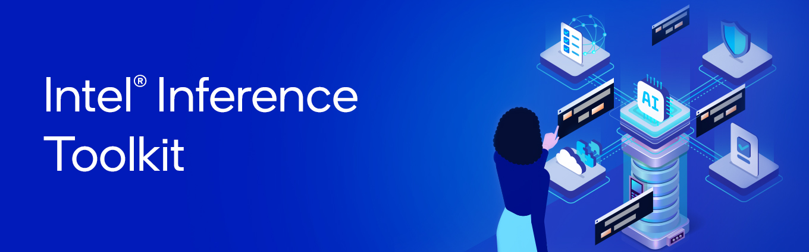
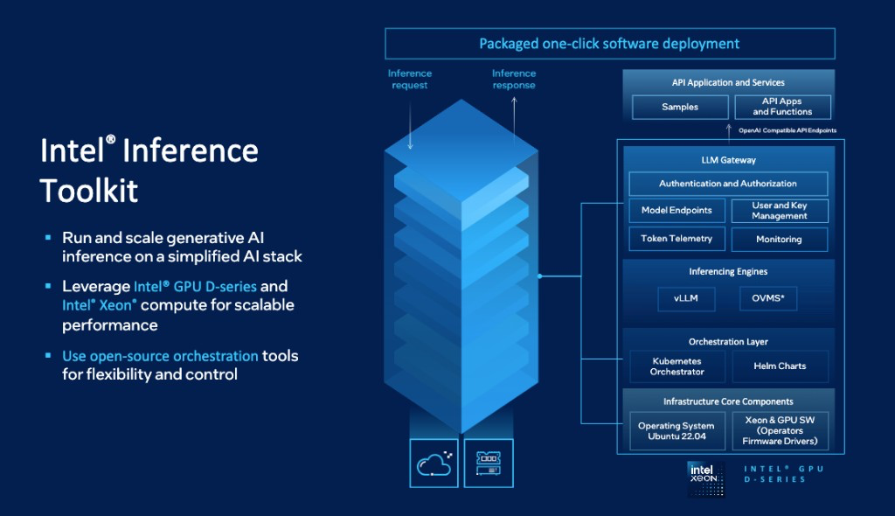

# Intel® Inference Toolkit

[](https://www.apache.org/licenses/LICENSE-2.0)
[](https://github.com/intel/toolkit-manager)
[](https://www.intel.com)
[](https://kserve.github.io/website/)
[](https://vllm.ai)
[](https://platform.openai.com/docs/api-reference)

**Serve Hugging Face models on Intel® Xeon® CPUs or Intel® Arc™ GPUs with one command.**

---

## What is Intel® Inference Toolkit?

Serving a model normally means sizing CPU and memory, pinning cores, downloading weights and wiring a gateway route, for every model. Intel® Inference Toolkit does that with one command.

You describe a model once in `models.yaml`, or point `--hfid` at a Hugging Face repo, and `model-manager` resolves the configuration, checks the requested CPU fits the node, downloads the weights, creates the serving pod, and registers the model with the gateway.

The result is a single OpenAI-compatible endpoint. The `model` field in the request body selects which model answers, so any OpenAI SDK client works unchanged.

<p align="center">
  
</p>

How it is built and how a request reaches a model: [Architecture](docs/reference/architecture.md) and [Inference Request Flow](docs/reference/request-flow.md).

---

## Quick Start

In three steps you install Intel® Inference Toolkit, deploy a model, and see it answer.

> [!NOTE]
> **Before you start:** [Toolkit Manager](https://github.com/intel/toolkit-manager) installs and
> operates this toolkit. Get it, prepare the machine, and create an environment, then run every
> command below from the Toolkit Manager folder:
>
> ```bash
> git clone https://github.com/intel/toolkit-manager.git
> cd toolkit-manager
> ./toolkit_manager.sh configure        # one-time machine prep; answer y to the prompt
> ./toolkit_manager.sh init inference   # creates env/local/ and downloads this toolkit
> ```
>
> Requirements: see [Prerequisites](docs/getting-started/prerequisites.md).

### Step 1 — Install the inference stack

Installs the model-serving stack. No models are deployed yet.

```bash
./toolkit_manager.sh install inference      # allow up to an hour on a first install
export KUBECONFIG=$(pwd)/env/local/kubeconfig.yaml
```

A successful run ends with an `INSTALLATION COMPLETE` banner.

To change settings, see [Configuration](docs/configuration/configuration.md).

### Step 2 — Deploy a model

```bash
./model-manager deploy qwen3-0-6b --wait
```

Or skip the catalog and deploy a Hugging Face model directly:

```bash
./model-manager deploy --hfid Qwen/Qwen3-0.6B --cpu 8 --wait   # memory sized from the model
```

`--wait` blocks until the model is ready (up to 15 minutes by default).

> [!IMPORTANT]
> Gated models (Llama, Mistral, Gemma) require a free [Hugging Face token](https://huggingface.co/settings/tokens).
> Run `export HF_TOKEN=hf_...` before deploying.

When the command returns it prints the inference endpoint and a ready-to-run `curl` example. Full flag reference → [Deploy a Model](docs/getting-started/deploy-models.md).

### Step 3 — Send your first request

Requests need a sign-in token. This script gets one for you:

```bash
source ./ext/enterprise.ai-inference/model_manager/scripts/get-keycloak-token.sh
# Exports: TOKEN, GATEWAY_IP, GATEWAY_DOMAIN, GATEWAY_URL
```

Call the model. The `model` field selects which one answers:

```bash
curl -s --noproxy '*' \
  --cacert env/local/logs/toolkit-manager-ca.crt \
  --resolve "$GATEWAY_DOMAIN:443:$GATEWAY_IP" \
  -H "Authorization: Bearer $TOKEN" \
  -H "Content-Type: application/json" \
  -d '{"model":"qwen3-0-6b","messages":[{"role":"user","content":"Hello!"}],"max_tokens":64}' \
  "$GATEWAY_URL/v1/chat/completions"
```

A JSON reply with a `choices` list means the model is serving. The token lasts 15 minutes; `source` the script again for a new one.

Using LiteLLM virtual keys (`auth_type: litellm_vkey`) instead? See [Accessing Models](docs/getting-started/accessing-models.md).

---

## Advanced

| Goal | Guide |
|---|---|
| Deploy, update, and remove models | [Deploy a Model](docs/getting-started/deploy-models.md) |
| Endpoints and authentication modes | [Accessing Models](docs/getting-started/accessing-models.md) |
| Add models — the `models.yaml` catalog | [Model Catalog](docs/configuration/catalog.md) |
| Engines, versions, and per-workload defaults | [Runtimes](docs/configuration/runtimes.md) |
| All configuration options | [Configuration](docs/configuration/configuration.md) |
| Components, roles, and how Toolkit Manager installs this toolkit | [Architecture](docs/reference/architecture.md) |
| How a request reaches a model | [Inference Request Flow](docs/reference/request-flow.md) |
| Content-safety screening of LiteLLM requests | [Guardrails](docs/configuration/guardrails.md) |
| Route each request to a model by prompt | [Hybrid Router](docs/configuration/hybrid-router.md), [vLLM Semantic Router](docs/configuration/semantic-router.md) |
| NUMA-aware CPU pinning | [CPU Pinning & NUMA](docs/reference/cpu-pinning.md) |
| Something isn't working | [Troubleshooting](docs/faq-and-troubleshooting/troubleshooting.md) |

Every guide: [Documentation Index](docs/README.md).

---

## License

Licensed under the [Apache License, Version 2.0](https://www.apache.org/licenses/LICENSE-2.0).

*Intel®, Intel® Xeon® and Intel® Arc™ are trademarks of Intel Corporation or its subsidiaries.*
